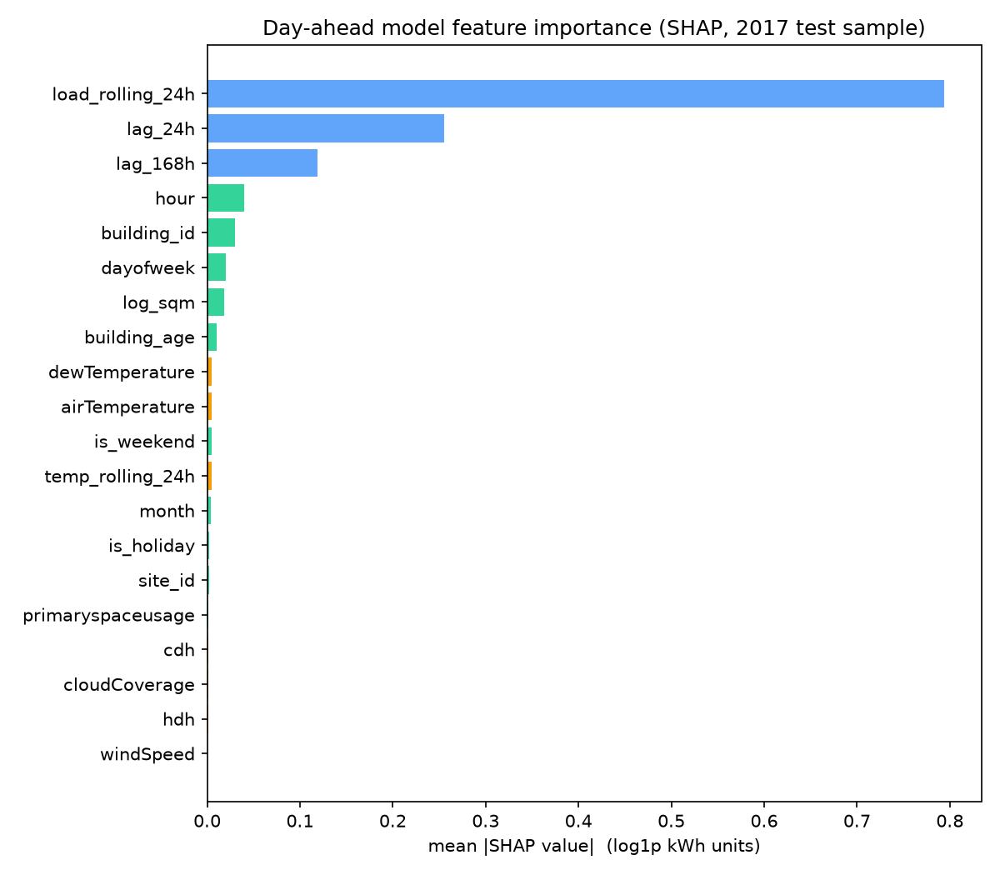
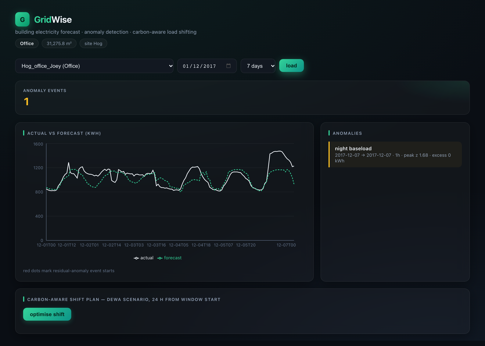
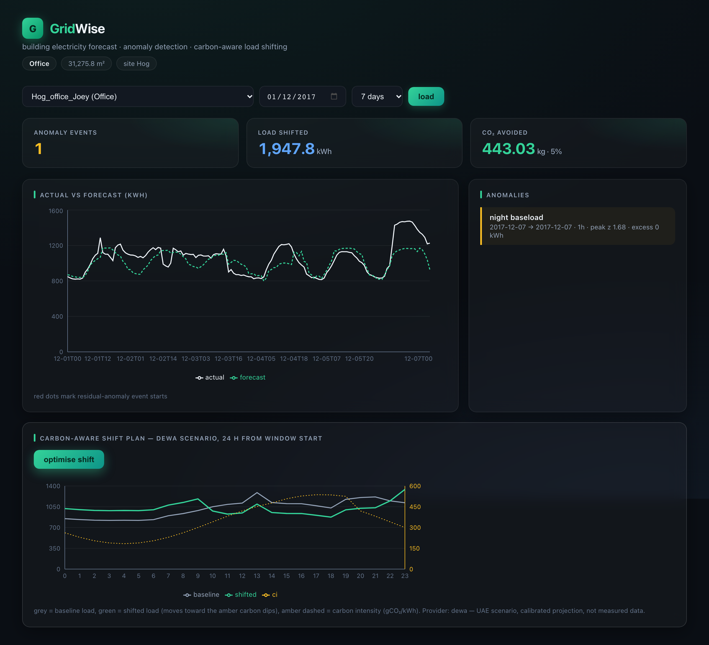

# GridWise

**AI building-energy optimiser: hourly load forecasting, anomaly detection, and carbon-aware load shifting.**

GridWise predicts how much electricity a building *should* use, flags the hours where it uses more, and tells the operator when to run flexible loads (HVAC pre-cooling, EV charging, water heating) so they draw the cleanest grid power. It reports the kWh moved and the CO₂ avoided.

Built on the [Building Data Genome Project 2](https://github.com/buds-lab/building-data-genome-project-2) benchmark — the field-standard open dataset of hourly smart-meter data — and scored against ASHRAE Guideline 14 calibration criteria.

## Results

Held-out test year (2017, never seen in training), 131 buildings, 1.12M hourly predictions:

| Model | CV(RMSE) | NMBE | RMSLE | MAE (kWh) |
|---|---|---|---|---|
| Seasonal-naive baseline | 43.8% | −0.1% | 0.292 | 21.0 |
| Weather-only (M&V / anomaly layer) | 49.7% | −1.7% | 0.352 | 30.8 |
| **Day-ahead (weather + lags)** | **26.6%** | **−1.5%** | **0.180** | **13.8** |

- **39.2% error reduction** vs the seasonal-naive baseline.
- Meets the ASHRAE Guideline 14 hourly calibration targets (CV(RMSE) ≤ 30%, NMBE within ±10%).
- The weather-only model *losing* to the naive baseline is by design: it is the measurement & verification layer. Lag features would leak an anomaly into its own prediction and shrink the residual — so the anomaly detector consumes this lag-free model, and the operational day-ahead forecast uses the lagged one.
- Anomaly detection validated by synthetic fault injection (a +3σ 5-hour plateau is flagged with z-scores 4–7; a single-hour spike is correctly ignored).
- Carbon-aware shift demo: moving 8.2% of a large office's daily load saves **5.2% of its CO₂** (581 kg/day, DEWA scenario curve) with energy exactly conserved and all per-hour caps respected — guaranteed by property tests.

## Feature importance (SHAP)

Exact Shapley values (TreeExplainer) on a 20k-row sample of the 2017 test set:



Read: the building's **own recent load history dominates** — the trailing 24h mean and the 24h/168h lags carry most of the signal, which is exactly why the day-ahead model beats the seasonal-naive baseline (which uses only lag-168h) and why the weather-only M&V model is deliberately lag-free. Weather contributes shape (temperature response) but not level; `building_id` and size capture the cross-building scale.

## Architecture

```
            BDG2 CSVs                     GB Carbon Intensity API
                │                                   │
        ┌───────▼────────┐                 ┌────────▼────────┐
        │ ETL (pandas)   │                 │ CarbonProvider  │
        │ clean, join,   │                 │ uk | dewa | csv │
        │ parquet out    │                 └────────┬────────┘
        └───────┬────────┘                          │
        ┌───────▼────────┐   model.joblib  ┌────────▼────────┐
        │ Train LightGBM ├────────────────►│  FastAPI        │
        │ + evaluate     │                 │  /forecast      │
        └───────┬────────┘                 │  /anomalies     │
        ┌───────▼────────┐                 │  /shift         │
        │ Anomalies      ├────────────────►│  /carbon        │
        │ (robust z)     │                 └────────┬────────┘
        └────────────────┘                          │ JSON
                                            ┌───────▼────────┐
                                            │ Next.js + charts│
                                            └─────────────────┘
```

**Pipeline** — one parquet, one feature builder, one config; training and serving import the same `build_features()`, so they cannot drift apart. Time-based split (train Jan–Sep 2016, validation Oct–Dec 2016, test all of 2017 — never shuffled). The seasonal-naive baseline is a first-class model: every headline number is measured against it.

**Carbon-aware shifting** — a greedy, fully explainable optimiser: sort hours dirty→clean, move each hour's flexible share (default 15%) into the remaining headroom (default +20%) while the marginal gain clears 10 gCO₂/kWh. Property tests guarantee energy conservation, cap respect, non-negative savings, and zero movement on a flat carbon curve.

**Carbon providers** — the UK grid signal is live (carbonintensity.org.uk); the UAE is a labelled scenario (DEWA mean factor with a midday solar dip); a CSV provider keeps the demo working offline.

## Quickstart

Prerequisites: Python 3.11+, `uv`, Node 18+, ~2 GB disk for the dataset. On macOS, LightGBM needs OpenMP: `brew install libomp`.

```bash
git clone https://github.com/PRNV0612/GridWise && cd GridWise

# 1. Data: clone BDG2 (Git LFS, ~1.5 GB)
brew install git-lfs && git lfs install
git clone --depth 1 https://github.com/buds-lab/building-data-genome-project-2 data/raw/bdg2

# 2. Python environment + pipeline (ETL → train → anomalies)
uv venv .venv --python 3.11
uv pip install --python .venv/bin/python -e ".[dev]" ".[shap]"
.venv/bin/python -m gridwise.etl       # cleaned parquet, 131 covered meters
.venv/bin/python -m gridwise.train     # LightGBM models + metrics.json
.venv/bin/python -m gridwise.anomalies # anomaly flags
.venv/bin/python -m pytest tests -q    # 20 tests

# 3. API
.venv/bin/uvicorn gridwise.api.main:app   # http://localhost:8000/docs

# 4. Dashboard (new terminal)
cd web && npm install && npm run dev       # http://localhost:3000
```

Interactive API docs: `http://localhost:8000/docs`.

## Screenshots

**Forecast & anomalies** — actual (white) vs forecast (green) hourly load, red dots marking anomaly event starts, anomaly list at right:



**Carbon-aware shift plan** — the optimiser moves flexible load toward the amber carbon-intensity dips; savings cards show kWh moved and CO₂ avoided:



## Honesty caveats (read before quoting numbers)

1. **The meter data is 2016–17, not 2026.** BDG2 is the benchmark every serious paper in this space uses; the load model is trained and scored on it, and that is stated plainly. Current-year relevance is carried by the **live** UK carbon signal and the UAE scenario — never by claiming the load data is current.
2. **UAE figures are calibrated projections.** No public hourly smart-meter data exists for the Gulf region (verified against KAPSARC, bayanat.ae and data.dubai in Nov 2026 — the best public UAE data is annual GWh per utility). The `DewaCarbonProvider` curve is DEWA's published grid emission factor (~0.35 kgCO₂/kWh, falling with the Mohammed bin Rashid Solar Park) with a modelled solar shape, anchored to KAPSARC's DEWA annual consumption (`data/uae/kapsarc_dewa_annual.csv`). Every UAE-derived number is labelled a scenario.
3. **The carbon signal is a different grid than the buildings.** The buildings are in North America and Europe; the default live carbon curve covers Great Britain. The shifting logic is grid-agnostic (any gCO₂/kWh curve works) and `CarbonProvider` is the swap point for Electricity Maps / WattTime / any real grid.
4. **Segment errors are concentration-driven.** Office CV(RMSE) of 43% is dominated by three large, volatile buildings carrying ~69% of the segment's squared error — the model beats the naive baseline on 21 of 22 office buildings individually.
5. **Anomalies have no ground-truth labels** (true of the whole domain). Detection is validated by synthetic fault injection, which measures detection power — not the false-positive rate on legitimately spiky buildings (EV charging, labs, batch processes).

## Project layout

```
gridwise/
├── config.py        # single source of truth: paths, thresholds, split years
├── etl.py           # melt, fault cleaning, coverage filter, weather join
├── features.py      # calendar + weather + building features + lags (shared train/serve)
├── train.py         # time-split LightGBM training + evaluation vs baseline
├── evaluate.py      # ASHRAE G14 metrics: CV(RMSE), NMBE, RMSLE, MAE
├── anomalies.py     # robust z-score + night baseload + stuck meter flags
├── carbon.py        # CarbonProvider: UK (live) / DEWA (scenario) / CSV
├── shifting.py      # greedy carbon-aware shift optimiser
└── api/main.py      # FastAPI service
web/                 # Next.js dashboard
notebooks/01_eda.ipynb
data/uae/            # committed KAPSARC DEWA calibration anchor
```

Raw data and models are gitignored; only code, the UAE anchor and EDA plots are committed.
